# REFERENCES-2: moodboard for the ScreenExtend redesign

Captured 2026-11-17 with Playwright (Chromium) at 1440×900, light scheme, DPR 1. Each site has two shots in
`refs/`: `<slug>-1.png` (first viewport) and `<slug>-2.png` (scrolled to y = 1800). Raw numbers are in
`refs/measure.json`, produced by `cap.js` in the session scratchpad.

How the numbers were taken:
- **Brand-colour share** is the percentage of first-viewport pixels with HSL saturation > 0.25 and channel spread > 0.12,
  sampled every 4th pixel. Neutrals and photos with muted colour count as zero. Hues are bucketed to 30°.
- **Headline px** is the largest computed `font-size` on visible text in the first viewport. **Body px** is the font size
  carrying the most characters in `p/li/span/a/div` runs longer than 40 characters.
- **Hex values** were sampled from the screenshots.
- **Section rhythm** comes from the `top`, `height`, `background-color` and `padding-top` of `section`, `main > div` and
  `footer` elements taller than 200px.

Where a measured number is wrong (a carousel slide sitting off-screen, a headline rendered as an image), the entry says so
and gives an estimate read from the screenshot.

## The ten references

| # | Site | Source | Why it's here |
|---|------|--------|---------------|
| 1 | [rauno.me](https://rauno.me/) | craft list | flat colour fields and extreme type, nothing else |
| 2 | [linear.app](https://linear.app/) | craft list | the real product is the hero, with mono figure labels |
| 3 | [culturedcode.com/things](https://culturedcode.com/things/) | craft list | quiet tinted bands and real UI at true scale |
| 4 | [ia.net/writer](https://ia.net/writer) | craft product | one flat cyan taken from the app's cursor, run as full-bleed bands |
| 5 | [figma.com](https://www.figma.com/) | craft list | a product screenshot set on one big colour field |
| 6 | [ableton.com/en/live](https://www.ableton.com/en/live/) | craft product | 280px wordmark, pure primary flats, annotation card on product |
| 7 | [are.na](https://www.are.na/) | craft product | deliberately flat type scale and an annotated product screenshot |
| 8 | [1984.vc](https://1984.vc/) | **SiteInspire** (Technology / Minimal) | three flat colour tiles fill about half of the first viewport |
| 9 | [town.com](https://www.town.com/) | **SiteInspire** (Technology / Typographic) | 80px slab headline with an image set inline in it |
| 10 | [semaloop.com](https://semaloop.com/) | **SiteInspire** (Technology) | inset flat green panel with a leader-lined UI callout |

### 1. rauno.me
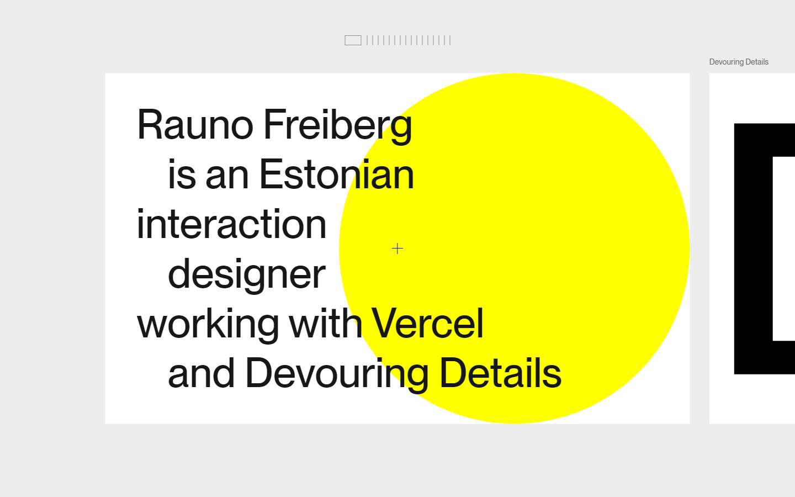 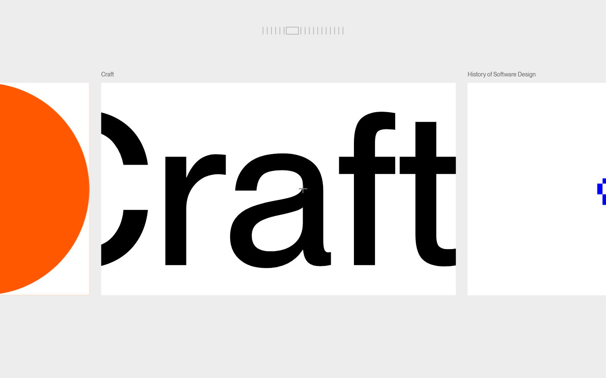
- **Brand-colour share:** 24%, all at hue 60° (one flat yellow `#ffff02` disc). The rest is 69% light (`#ededed` page, white cards).
  The scrolled shot uses flat orange `#ff5800` and pure blue in the same way.
- **Type scale:** the hero sentence is 75px against 14px labels, a 5.4× ratio. The "Craft" card sets its word at an estimated
  ~500px (the letter height is about 360px in `rauno-2`), roughly 35× the labels. The measurement script reported 720px for an
  off-screen slide, so ignore that figure.
- **Type families:** one neo-grotesk, served under the CSS alias `X`. There is no second family.
- **Product staging:** there is no screenshot. Each card is a 1058×636 white panel holding a single flat shape and one word.
  The next card bleeds about 155px off the right edge, which tells you the strip continues.
- **Rhythm:** a single horizontal strip of cards with about 36px gutters. Grey page, white card, one colour shape per card.
- **Detail trick:** a tick-mark ruler at the top centre works as the page index. The current card is drawn as a hollow
  rectangle among hairline ticks.

### 2. Linear
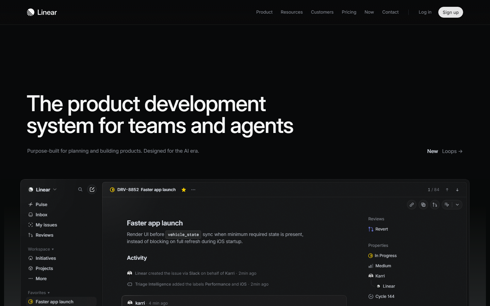 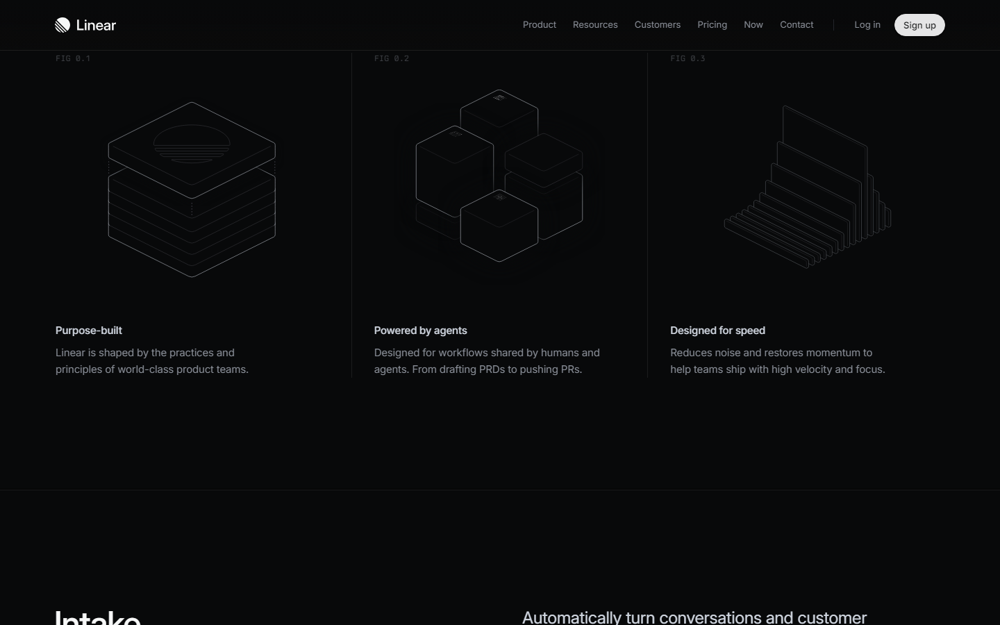
- **Brand-colour share:** 0%. The page is 96% dark `#08090a`, so the only colour comes from status dots inside the product UI.
- **Type scale:** 64px headline (weight 510, letter-spacing -1.408px, about -2.2%) against 15px body: 4.3×. The h2s are 48px.
- **Type families:** Inter Variable, plus Berkeley Mono for labels.
- **Product staging:** the real app at full width (1440×804). It starts at y = 491, fills 45% of the first viewport and runs
  off the bottom. It sits in a 1px border with a corner radius of about 12px, with no device frame. Caveat: there is a slight
  dark fade at the bottom edge of the image. Don't copy that part.
- **Rhythm:** feature sections are about 1240px tall with 128px top padding, separated by 1px hairlines. The background never
  changes colour.
- **Detail trick:** each diagram has a mono caption, `FIG 0.1 / 0.2 / 0.3`, set in the top-left corner of its column. This
  reads as an engineering drawing. The diagrams themselves are line art.

### 3. Things (Cultured Code)
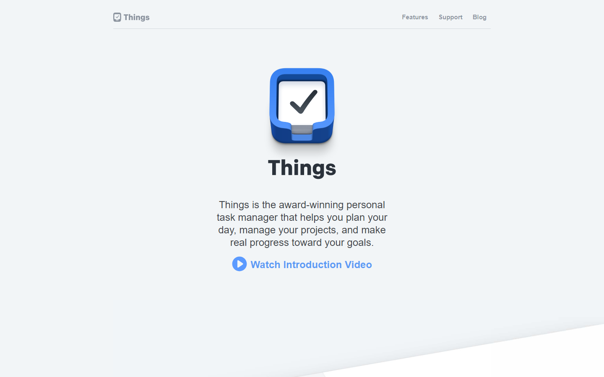 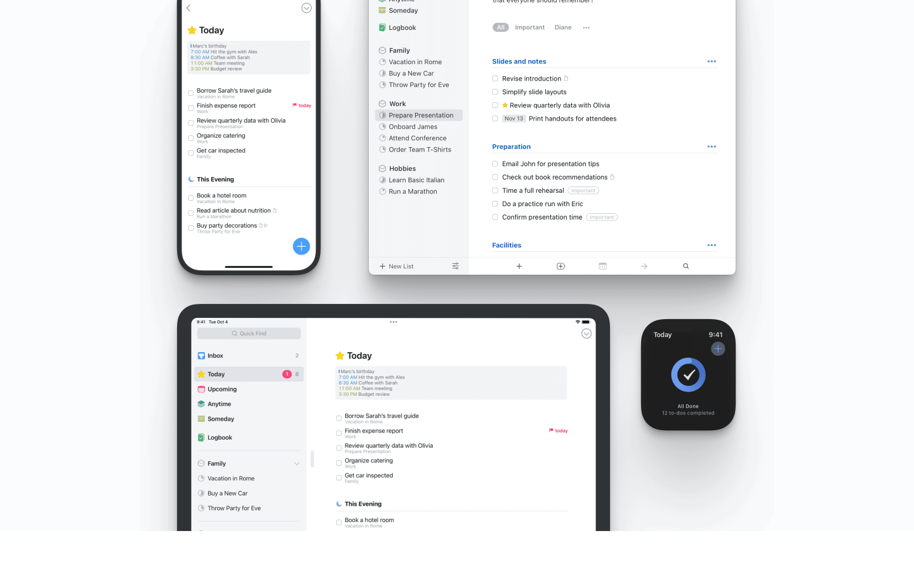
- **Brand-colour share:** 2% (the blue app icon and link). 97% light.
- **Type scale:** body 18px, h2 36px: 2×. The hero "Things" wordmark looks about 56px. The script measured 24px, which is
  probably the hidden real h1. This is the calm end of the range.
- **Type families:** the system stack (`ui-sans-serif`, which renders as SF Pro on Apple devices).
- **Product staging:** real UI at 1:1 on iPhone, Mac, iPad and Watch, arranged as a staggered cluster that the viewport crops
  at the top. The hero itself is only the icon.
- **Rhythm:** backgrounds alternate `#f2f5f7` → `#fbfcfe` → `#fff` → `#f2f5f7`, with 81px padding and sections 888 to 2674px tall.
  The tint changes are barely visible but still mark each section.
- **Detail trick:** the hero ends on a diagonal edge, a white wedge cutting up from the bottom-right, instead of a horizontal rule.

### 4. iA Writer
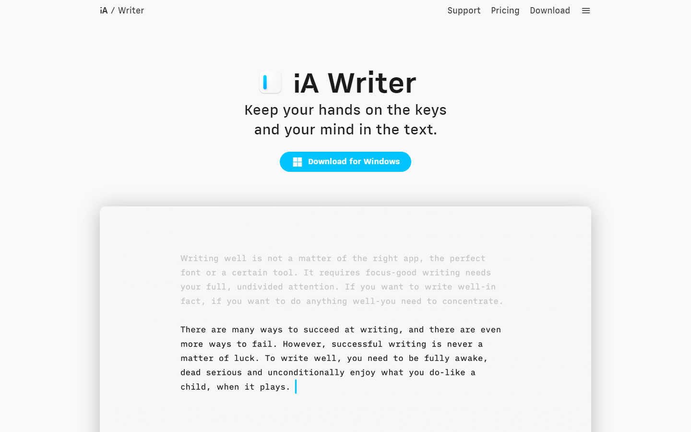 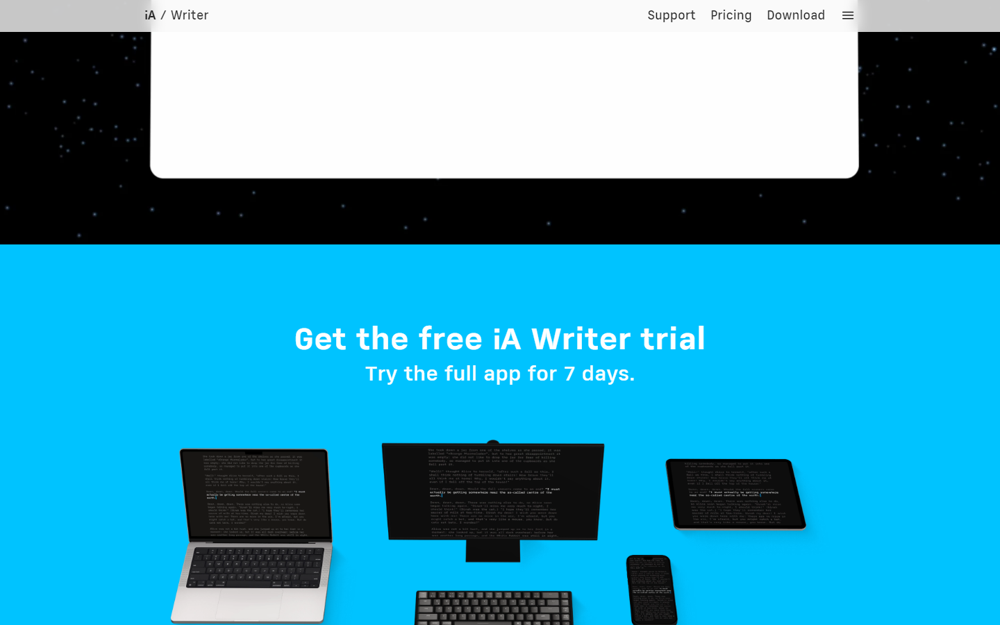
- **Brand-colour share:** 1% in the first viewport (the cyan cursor and button). The scrolled shot is about 61% flat cyan
  `rgb(0,195,255)`, a full-bleed band 893px tall.
- **Type scale:** 57px headline against 20px body: 2.85×. A 28.5px sub-deck sits in between.
- **Type families:** iA Sans Day and iA Sans Night (their own faces), with iA Writer's monospace inside the product image.
- **Product staging:** the editor (1024×576 at y = 430) fills 37% of the first viewport and runs off the bottom. The crop shows
  only the writing surface, with no window chrome or toolbar, so the visible product is its own type and a cyan cursor.
  Caveat: there is a soft drop shadow under the panel and device renders lower on the page. Copy neither.
- **Rhythm:** the cyan band returns at regular intervals (y = 2152, 7479, 10228) between `#f9f9f9` sections, with one `#141414`
  dark band. Cyan bands have 115px padding, grey ones 100.8px.
- **Detail trick:** one accent, taken from the product (the caret colour), used for the cursor, the download button and the
  full-bleed bands. There is nothing else.

### 5. Figma
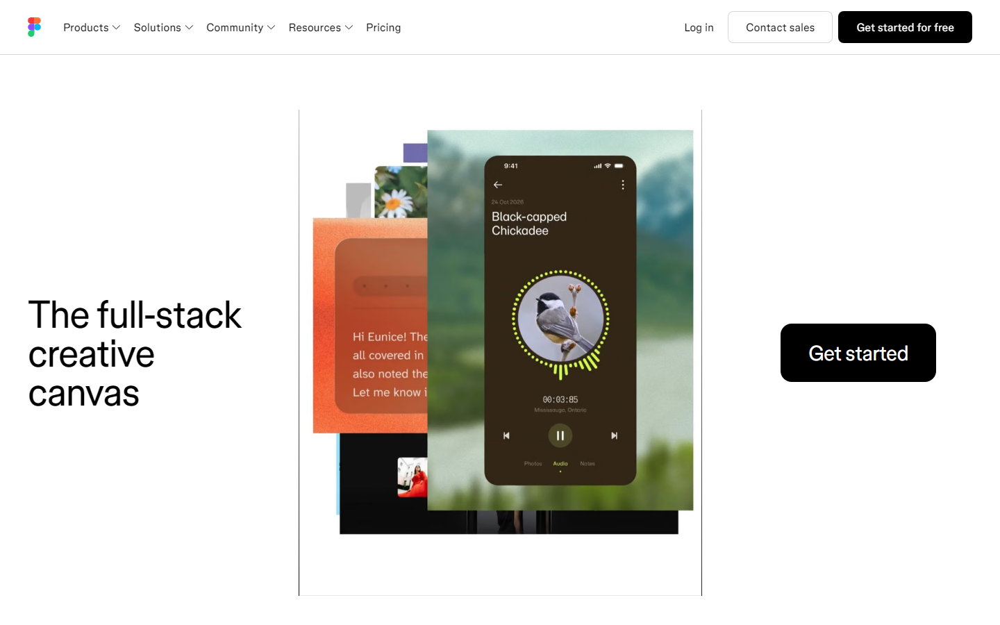 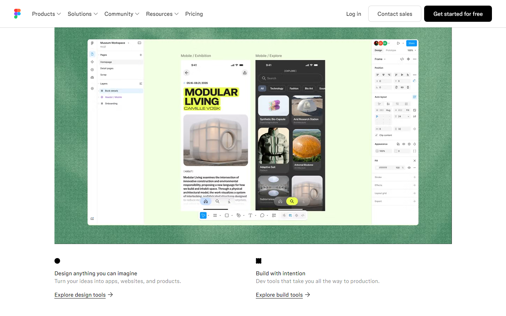
- **Brand-colour share:** 7% in the first viewport. In the scrolled shot, one colour field covers about 54% (1131×617 of 1440×900).
- **Type scale:** 56px h1 against 16–18px body: about 3.3×. Section leads are 30px and 44px.
- **Type families:** figmaSans and figmaMono.
- **Product staging:** a real editor screenshot (about 940×530) inset on a colour field with about 94px of margin on every side.
  There's no frame and no shadow, so the field acts as the mat. Caveat: Figma's field is a textured green felt photo
  (`#649c79`), not a flat fill. Borrow the proportions, not the texture.
- **Rhythm:** every section is white with 80px top padding, closed by a black footer with 120px padding. All the variation
  comes from the colour fields behind the screenshots.
- **Detail trick:** under each product field, a small solid black glyph works as the bullet for a two-column caption. Each
  caption ends in an underlined text link with an arrow, and there's no button.

### 6. Ableton Live
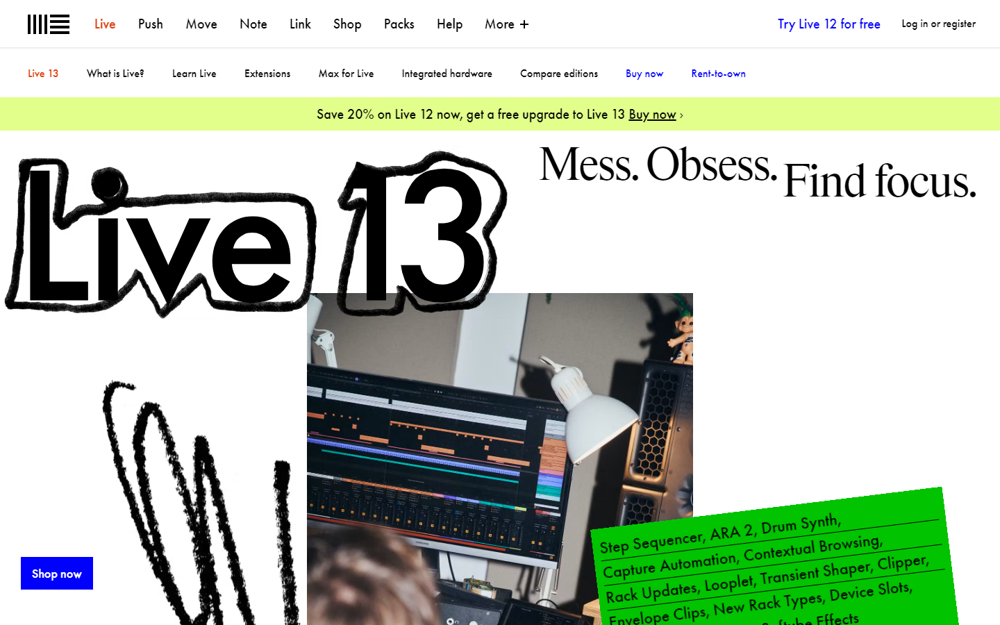 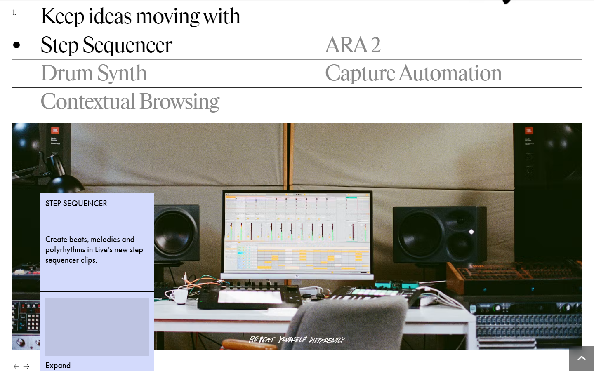
- **Brand-colour share:** 14%, made of a flat green sticker `#01c300`, a pale-lime promo bar `#e1ff8a` and a pure `#0000ff`
  button. All three are flat primaries.
- **Type scale:** the "Live 13" wordmark is set at **280px** (letter-spacing -7px) against 16px body: **17.5×**. The h2 is
  208px, and the serif tagline is about 70px.
- **Type families:** Futura PT for the UI and wordmark, Rhymes Display for the editorial serif ("Mess. Obsess. Find focus.").
- **Product staging:** a photo of Live running on a studio monitor (556×835, 20% of the viewport) runs off the bottom. The
  280px wordmark overlaps its top edge, and a flat green label card listing the new features overlaps its bottom-right
  corner, so the image is annotated with text instead of icons. Caveats: the hand-drawn scribble is drawn on a page-wide
  `<canvas>`, and the card is rotated. Both are out of bounds for ScreenExtend.
- **Rhythm:** full-bleed white sections 980 to 1500px tall with 0px padding, so the images supply the spacing. There is one
  deep-teal `rgb(0,58,88)` band with 105px padding.
- **Detail trick:** promo strip in pale lime, primary links in pure `#0000ff` with no hover colour, and the current section's
  nav item in orange. It's 1990s software colour used on purpose.

### 7. Are.na
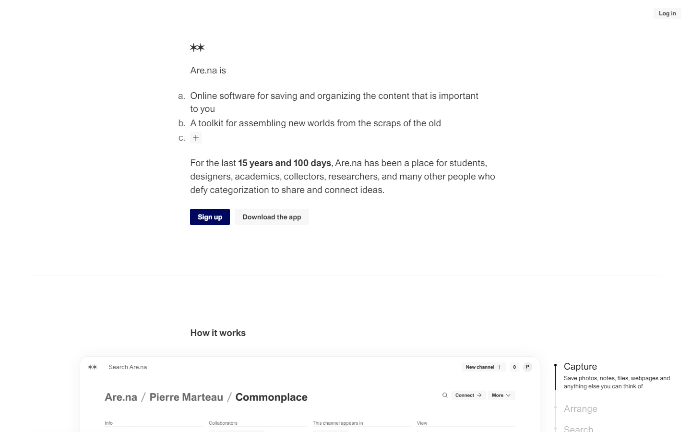 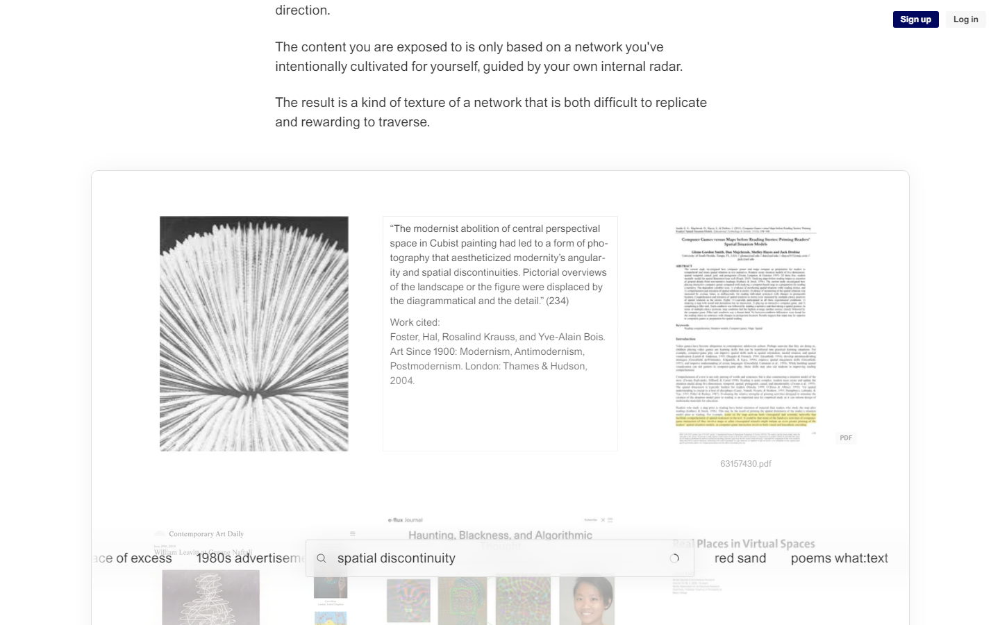
- **Brand-colour share:** 0%. Colour is limited to one navy `#00075f` button, which the footer band repeats.
- **Type scale:** 19.2px headline and 19.2px body: **1×**. All hierarchy comes from position, a./b./c. markers, weight and
  hairlines. This is the opposite extreme from Ableton, and it works for the same reason: it is a deliberate choice.
- **Type families:** "areal" (a grotesk) plus Times New Roman for quotations.
- **Product staging:** a real app screenshot (958×656 at y = 743, under "How it works") in a 1px rounded frame. To its right is
  a vertical step list (Capture / Arrange / Search) with a tick on the active step, which works as an annotation.
- **Rhythm:** no background changes. Sections of 250 to 1100px are separated by one full-width hairline, closed by a navy footer
  with 65px padding.
- **Detail trick:** the hero copy is a lettered definition list, "Are.na is a. … b. … c. +". The third item is an empty "+",
  so the definition stays open-ended.

### 8. 1984 Ventures (SiteInspire)
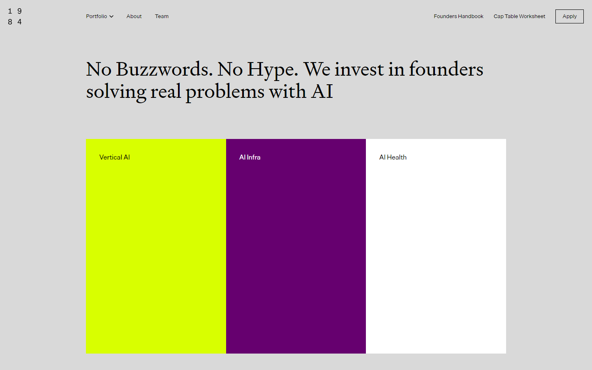 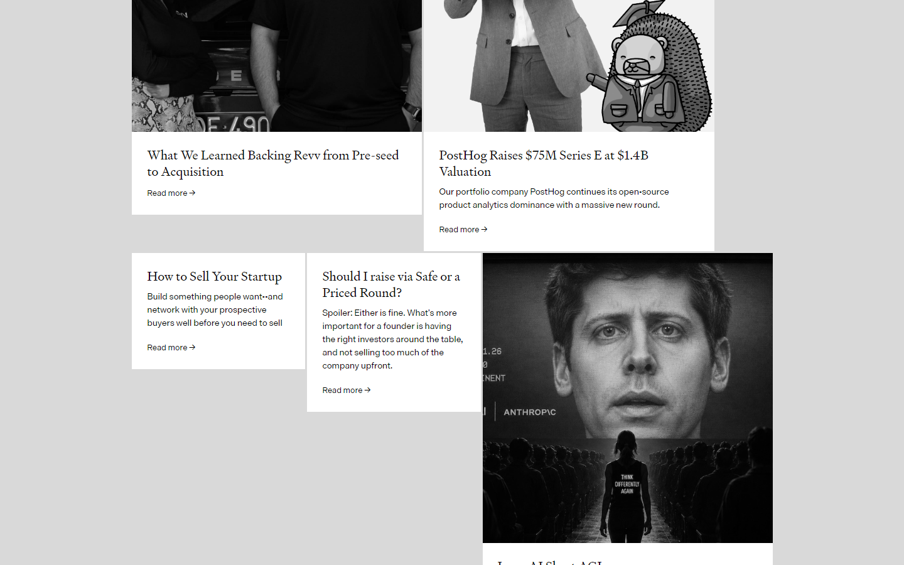
- **Brand-colour share:** **28%**, half lime `#d8ff00` and half plum `#66006f` (14% each), on a `#d9d9d9` page. Including the
  white third tile, the three tiles fill about 46% of the viewport (1021×522).
- **Type scale:** 48px headline against 14px body: 3.4×. The 38px Signifier is used for pull text.
- **Type families:** Signifier (Klim) for display, Die Grotesk A for UI.
- **Product staging:** no product. The three equal tiles (lime, plum, white, each 340×522) are the category navigation, each
  with one 16px label in its top-left corner.
- **Rhythm:** sections of 258, 522, 2051 and 651px with 80px padding, ending in a black footer.
- **Detail trick:** the logo is the year set as a 2×2 monospace grid ("1 9 / 8 4") in the top-left corner.

### 9. Town (SiteInspire)
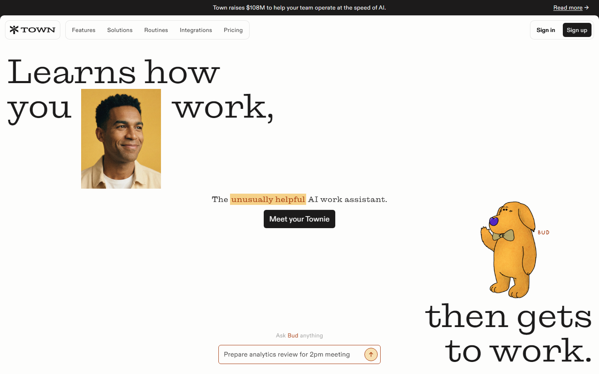 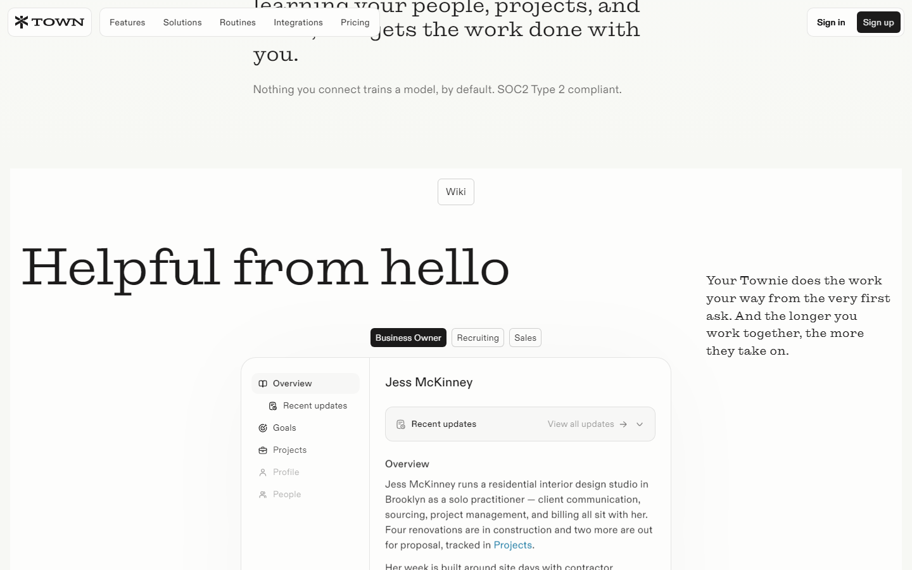
- **Brand-colour share:** 5%: the warm mustard portrait background and a highlighter on "unusually helpful". 87% light, on an
  off-white `#fdfdfc`.
- **Type scale:** 80px h1 (weight 84, line-height 83px, -1.6px tracking) against 14px body: **5.7×**. Every h2 is also 80px,
  so section headings carry the same weight as the hero.
- **Type families:** a custom wide slab ("slab"), a grotesk ("sans") and a handwriting face for marginal notes.
- **Product staging:** the hero sets a 192×240 portrait photo **inside the headline**, between "you" and "work". The headline is
  split diagonally across the page, top-left to bottom-right. The scrolled section shows the real product UI panel at about
  700px wide.
- **Rhythm:** card sections with 16px insets alternate with full sections at 95–138px padding. There's one `#1c1b1b` dark band
  at y = 5538.
- **Detail trick:** a phrase highlighted with a flat marker fill, and a prompt box that pre-fills a real query ("Prepare
  analytics review for 2pm meeting") instead of placeholder text.

### 10. Semaloop (SiteInspire)
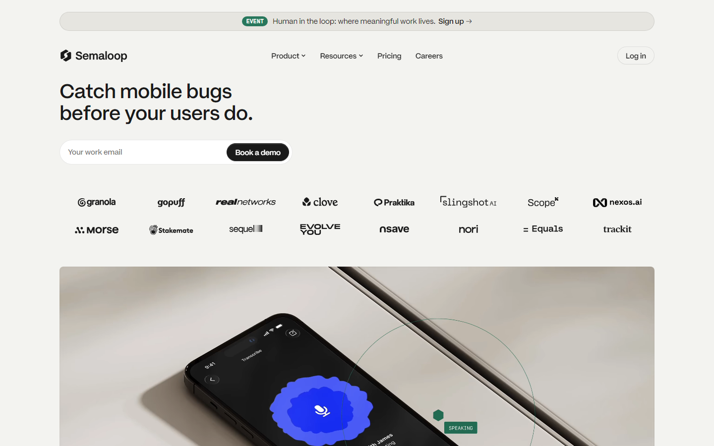 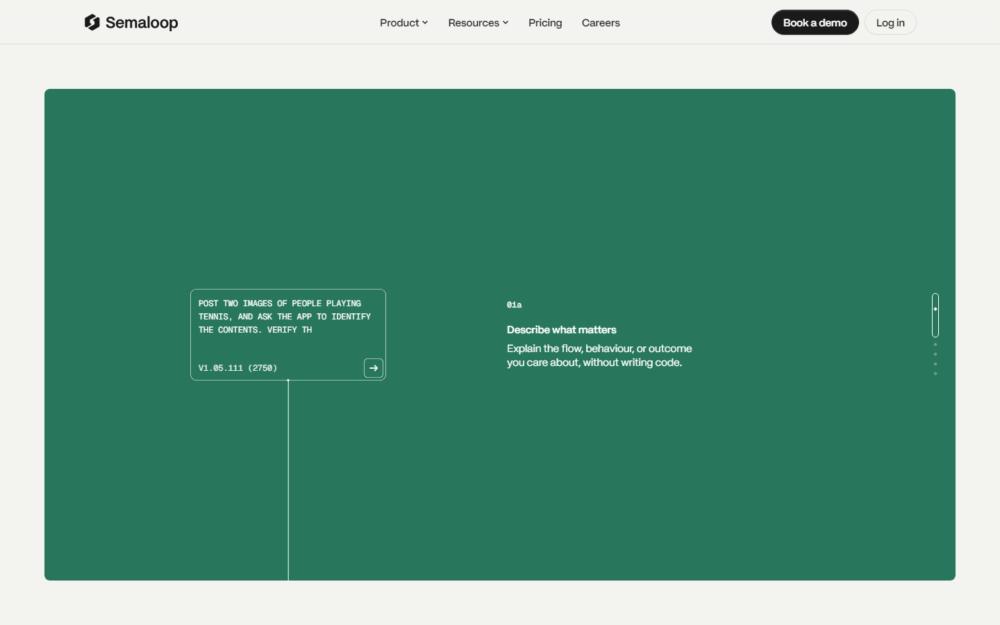
- **Brand-colour share:** 2% in the first viewport. In the scrolled shot, a flat green `#28775c` panel covers **72%**
  (1312×708) on a `#f3f3f0` page.
- **Type scale:** 40px h1 against 15px body: 2.7×. The h2s use the same 40px, and step titles are 23px.
- **Type families:** PP Mori, plus Geist Mono for step indices and the prompt card.
- **Product staging:** the hero is a 1200×600 product video starting at y = 538. In the scrolled section, the panel holds a
  1px-outlined card containing the real prompt in mono capitals. A 1px leader line drops from the card to the bottom edge of
  the panel. The explanatory copy sits to the right, keyed "01a".
- **Rhythm:** the panel is inset 64px from the viewport edges with an 8px radius, and the page colour shows around it. Later
  bands use `#e6e5e0` and `#b3c1b9`, both flat.
- **Detail trick:** a mono step index ("01a") plus the leader line connects the diagram and its caption without any icon.

## Considered and rejected

| Site | Result | Measured evidence |
|------|--------|-------------------|
| Raycast | glow | red diagonal light-streak hero on black; chroma 17%, all at hue 0° |
| Stripe | gradient | the signature colour ribbon; chroma 31% across three hues |
| Vercel | not captured | the 90s capture timeout was hit twice; the hero is also a gradient prism |
| Arc | n/a | the homepage is now a "farewell" sunset notice |
| Teenage Engineering | 3D / photo | home is a dramatically lit render (83% dark, 1% chroma); the EP-133 page is a full-bleed photo |
| Nothing | photo + consent wall | consent modal blocks the page; behind it are soft product photos |
| Playdate / Panic / Nova / Transmit | gradient or 3D | radial vignette and 3D device (Playdate), game-art photo (Panic), gradient logo and rule (Nova), yellow→orange gradient (Transmit) |
| Interfere (Godly) | glow | pink glow behind the hero product shot, otherwise a strong product-as-hero layout |
| Idle (SiteInspire) | glass + glow | frosted nav and an orange glow tile |
| Poetry Camera, Pear, Special Offer, Everyday, Daylight, Norma (SiteInspire) | photo/blur | blurred video or texture heroes; Daylight is a wavy orange gradient |
| Portal, CleanShot, Ivory | gradient / 3D | sky gradient, pastel card gradients, 3D illustration |

Godly now redirects to recent.design. Its current website entries are mostly agency or showreel sites, and the two product
sites checked (Interfere, Podium) failed on glow or a preloader-only first viewport. The three gallery picks therefore all
come from SiteInspire.

## Cross-reference: the numbers side by side

| Site | Colour share, viewport 1 | Peak colour field (any shot) | Headline : body | Type families | Product image share |
|------|-----------|------------------|-----------------|---------------|-------------------|
| rauno.me | 24% | ~24% (disc) | 75:14 (5.4×), card ~35× | 1 | n/a |
| Linear | 0% | 0% | 64:15 (4.3×) | 2 (sans + mono) | 45%, bleeds bottom |
| Things | 2% | ~3% | 36:18 (2×) | 1 (system) | cluster, cropped top |
| iA Writer | 1% | 61% cyan band | 57:20 (2.85×) | 2 + mono | 37%, bleeds bottom |
| Figma | 7% | 54% field | 56:18 (3.1×) | 2 (sans + mono) | ~40% on field |
| Ableton | 14% | 14% | **280:16 (17.5×)** | 2 (geometric + serif) | 20%, bleeds bottom, annotated |
| Are.na | 0% | navy footer | **19.2:19.2 (1×)** | 2 | ~49% (in scroll) |
| 1984 | **28%** | 46% tiles | 48:14 (3.4×) | 2 (serif + grotesk) | n/a |
| Town | 5% | dark band | 80:14 (5.7×) | 3 | photo inline in headline |
| Semaloop | 2% | **72% panel** | 40:15 (2.7×) | 2 (sans + mono) | 33% video; annotated card |

What this shows: none of the ten puts more than 30% saturated colour in the first viewport. Where colour runs big (Semaloop 72%,
iA 61%, Figma 54%), it arrives as a single flat field one scroll down, framing the product. The big type ratios (Ableton
17.5×, Town 5.7×, rauno 5.4×) belong to sites whose first viewport has almost no other decoration.

## Five moves ScreenExtend should borrow

Constraint key: **S** = static (no scroll motion, parallax, tilt or animated background) · **F** = flat (no gradient, glow or
glass) · **P** = palette only (`#316cff`, `#1ccbdd`, `#a6e15a` / `#dcff4a`, `#d6f1ed`, `#2456d6` + neutrals) ·
**V** = visuals are real screenshots or flat diagrams.

### 1. One full-bleed flat band for the download, coloured from the product (from iA Writer)
iA takes its caret cyan and runs it as an 893px full-bleed band with 115px padding, reused on the button and cursor. Nothing
else on the page is cyan. ScreenExtend should do the same for the Download section: a full-bleed **`#1ccbdd`** band about
800–900px tall at 112px padding, holding the download buttons and one real screenshot crop. Cyan then appears in only two
other places, both small (the focus ring and the inline link underline).
- **S** ✓ (a fill, no motion) · **F** ✓ (a single flat fill; drop iA's panel shadow) · **P** ✓ (`#1ccbdd`)
  · **V** ✓ (screenshot crop, not iA's device renders).
- Contrast check: white text on `#1ccbdd` is only about 2:1. Text on the band has to be the page ink (`--se-ink`, near-black,
  about 10:1).

### 2. Three equal flat tiles for the three pairing steps (from 1984 Ventures)
1984 splits a 1021×522 block into three 340px tiles of flat colour, about 46% of the first viewport, each with one 16px label
in its corner. Map the ConnectFlow "How pairing works" steps onto three tiles: **mint `#d6f1ed`** (01 Open the host app),
**lime `#dcff4a`** (02 Scan / type the URL), **deep blue `#2456d6`** (03 The browser becomes a display). Each tile holds one
real crop: the QR panel, the URL bar, the extended desktop.
- **S** ✓ · **F** ✓ (flat fills, square corners or `rounded-panel` 8px) · **P** ✓ · **V** ✓ (crops, no icons).
- Guardrail: each tile must hold a real screenshot crop. If the crop is replaced by an icon, the row becomes the
  icon-card grid the brief bans.
- Contrast check: text on `#2456d6` has to be white (about 6:1). Do not use `#316cff` for small text on white or under white
  text, because it comes out at about 4.4:1.

### 3. The real host app as the hero, bleeding off the fold, with FIG labels (from Linear)
Linear's first viewport is 64px type above a full-width app screenshot that fills 45% of the viewport and runs off the
bottom, in a 1px border with no device frame. Its diagrams carry mono `FIG 0.x` captions. ScreenExtend's hero should use the
real host-app window at ≥1200px wide, starting at about y = 480 so the bottom edge is cropped by the fold. Give it a 1px
`--se-line` border and `rounded-shot` (10px), and label the flat pairing diagram `FIG 1 / FIG 2` in the mono face.
- **S** ✓ · **F** ✓ (skip Linear's bottom fade; the crop is a hard edge) · **P** ✓ (neutrals; colour only from the app's own UI)
  · **V** ✓ (real screenshot, flat line diagram).

### 4. One headline at wordmark scale, about 12× body (from Ableton Live)
Ableton runs a 280px wordmark over 16px body (17.5×), and the photo of the product sits partly under it. ScreenExtend can
push one line, such as "Any screen." or the product name, to **192px** (12× the 16px body) with about -3% tracking. Let the
hero screenshot's top edge slide under its descenders, and keep every other heading at or below 48px so the jump stays
dramatic. Add one flat **lime `#dcff4a`** label card overlapping the screenshot's corner that lists real specs
("WebRTC · no install on the client · LAN only"). Set the card square, not rotated.
- **S** ✓ (no scribble canvas, no rotation) · **F** ✓ · **P** ✓ (lime card, ink text about 17:1)
  · **V** ✓ (the card is annotation on a real screenshot).
- At 390px width, scale it to about 72px (4.5×) so it never forces horizontal scroll.

### 5. An inset flat panel with a leader-lined callout for the host-app tour (from Semaloop)
Semaloop insets a flat `#28775c` panel 64px from the viewport edges (72% of the viewport) and places a 1px-outlined UI card
on it. A 1px leader line runs from the card to the panel edge, with the caption keyed "01a" in mono. For FeatureScroll
("Inside the host app"), set each `crop-*.webp` on an inset **deep-blue `#2456d6`** panel (or mint for alternate items),
64px gutter, `rounded-panel`. Draw 1px leader lines from specific controls (resolution picker, display toggle, the pairing
QR) to mono labels `01a / 01b / 01c` with one-line captions.
- **S** ✓ (no sticky stepper; Semaloop's side dots mean nothing on a static page, so leave them out)
  · **F** ✓ (flat panel, 1px strokes) · **P** ✓ (`#2456d6` already used for the Technical details band, so it stays consistent)
  · **V** ✓ (real crops plus flat annotation lines).

### What not to borrow
Figma's felt texture, Ableton's scribble canvas and rotated card, iA's device renders and panel shadow, Linear's bottom fade,
rauno's horizontal carousel and crosshair cursor, and Things' device frames. Each one breaks a constraint above, or the
brief's "no device renders" rule.
